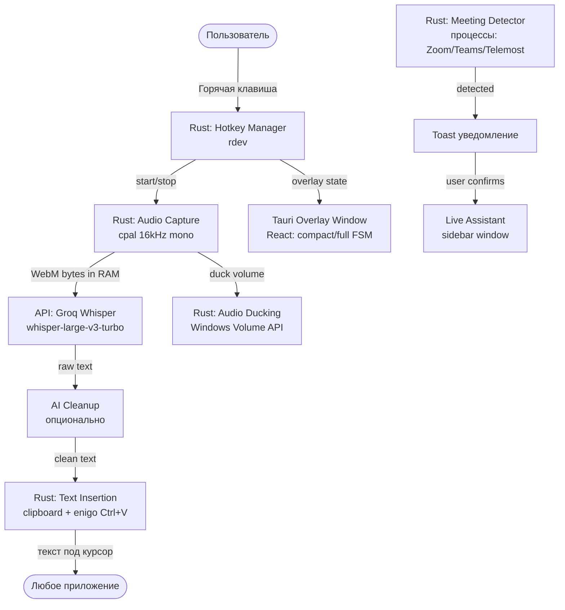

# Техническое задание (ТЗ)
## Проект: «Секретарь» — AI Voice-First Input Engine для Windows
### Версия: 2.0 (на основе реверс-инжиниринга SpeakFlow v1.3.93)

---

## 1. Обоснование и контекст

Данное ТЗ составлено на основе **прямого анализа** установленного приложения SpeakFlow (версия 1.3.93, Windows):
- Изучены логи запуска (`main.log`, 1465 строк)
- Изучена структура файлов (`app.asar`, `overlay/config.json`, `AudioCache`)
- Изучены IPC-обработчики, менеджеры и FSM-состояния оверлея
- Изучены все горячие клавиши из реальных настроек

**Ключевой инсайт:** SpeakFlow — это **Electron-приложение** (Node.js + Chromium), а не Tauri/Rust. Наш продукт «Секретарь» должен быть лучше: меньше весить, быстрее запускаться, потреблять меньше RAM. Поэтому **мы строим на Tauri 2.0 (Rust)**.

---

## 2. Что делает SpeakFlow: полный разбор

### 2.1 Модули и подсистемы (из логов IPC-регистрации)

| IPC-модуль | Функция |
| :--- | :--- |
| `IPC:App` | Управление жизненным циклом приложения, автозапуск |
| `IPC:SecureStore` | Зашифрованное хранение токенов авторизации (Yandex OAuth) |
| `IPC:Hotkey` | Управление горячими клавишами |
| `IPC:TextInsertion` | Вставка текста через clipboard + Ctrl+V эмуляция (`keysender`) |
| `IPC:Audio` | Захват аудио через `win-audio` N-API нативный модуль |
| `IPC:Overlay` | Управление плавающим оверлеем записи |
| `IPC:Clipboard` | Мониторинг и управление буфером обмена |
| `IPC:ScreenCapture` | Захват экрана (`node-screenshots-win32-x64`) |
| `IPC:LiveAssistant` | Live Assistant — боковая панель для встреч |
| `IPC:Update` | Автообновление (electron-updater) |
| `IPC:Meeting` | Детектор встреч (Zoom, Яндекс Телемост, Teams и др.) |

### 2.2 Горячие клавиши (реальные, из конфига)

```json
{
  "recording": "CommandOrControl+Space",
  "mode": "toggle",
  "translation": "CommandOrControl+Shift+T",
  "undo": "CommandOrControl+Shift+Z",
  "meeting": "CommandOrControl+Shift+M",
  "tabComplete": "CommandOrControl+Space",
  "unifiedMemory": "CommandOrControl+Shift+U"
}
```

**Два режима записи:**
- **hold** — запись идёт пока зажата клавиша (Push-to-Talk)
- **toggle** — одно нажатие = старт, второе = стоп

### 2.3 Реальный поток записи (из анализа логов)

```
Hotkey pressed (toggle)
  → Hidden focused mainWindow (скрывает главное окно чтобы не мешать)
  → Overlay FSM: compact → full (оверлей разворачивается)
  → TimerManager: start
  → Audio Ducking: duck системный звук с 86 до 25 (уменьшает громкость системы!)
  → IPC: recording-started
  
Hotkey pressed (toggle, stop)
  → Audio Ducking: restore volume
  → AudioCache: save audio_TIMESTAMP.webm (в AppData/Roaming/speakflow/audio-cache)
  → API call → transcription
  → IPC: insert-text (clipboard save → write → Ctrl+V → restore)
  → Overlay FSM: full → compact
  → AudioCache: mark as success
```

### 2.4 Audio Ducking — ключевая фича

SpeakFlow **автоматически снижает громкость системы** во время записи (с 86 до 25), чтобы микрофон не захватывал системный звук. После записи громкость восстанавливается. Это реализовано через нативный модуль `win-audio` (N-API).

### 2.5 Оверлей (Overlay FSM)

Конечный автомат с состояниями:
- **compact** — свёрнутый индикатор (кружок с иконкой)
- **full** — развёрнутая панель записи (виден таймер, кнопка стоп)

Конфиг оверлея хранится в `AppData/Roaming/speakflow/overlay/config.json`:
```json
{ "overlay": { "hidden": true } }
```

### 2.6 AudioCache

- Путь: `AppData/Roaming/speakflow/audio-cache`
- Формат: `.webm` (WebM аудио)
- Ограничение: **max 500 MB, 30 дней** хранения
- Пример: `audio_1787846480914.webm` (28.55 КБ за ~5 сек)
- При успешной транскрипции: `Marked as success`

### 2.7 MeetingDetector

SpeakFlow автоматически детектирует активные видеоконференции по именам процессов/окон:
- **Яндекс Телемост** (`Яндекс Телемост`, `Звонок в Яндекс Телемосте`)
- **Zoom** (`Zoom - Уведомление`)
- Teams, Google Meet и другие (по аналогии)

При обнаружении встречи — всплывает уведомление с предложением начать запись (15 сек таймаут автозакрытия). Пользователь может принять или отменить.

Запись встреч — отдельный сценарий с **LiveAssistantSidebar** (боковая панель).

### 2.8 ClipboardManager

Отдельный менеджер, который **следит за изменениями буфера обмена** (текст и изображения). При вставке текста через транскрипцию:
1. Сохранить текущий буфер
2. Записать транскрипт в буфер
3. Эмулировать Ctrl+V
4. Восстановить исходный буфер

Изображения из буфера сохраняются в `AppData/Roaming/speakflow/clipboard-images/` (PNG, с timestamp в имени).

### 2.9 Авторизация

- OAuth через **Яндекс** (deep link `speakflow://auth-from-deeplink`)
- Токены хранятся в зашифрованном хранилище (`secureStore`)
- Device verification при сохранении токенов

### 2.10 Подсистема Prewarm

При старте приложения — предварительное соединение с `https://api.speakflow.ru` (4 сокета параллельно). Цель — устранить задержку DNS lookup + TLS handshake для первого запроса.

### 2.11 Тарифная система (из сайта)

| Тариф | Цена | Ограничения |
| :--- | :--- | :--- |
| **FREE** | 0 ₽ | 30 минут/месяц |
| **Персональный** | 690 ₽/мес | Безлимит, без автосписаний |

### 2.12 Полный Feature List SpeakFlow

1. **Диктовка голосом** — вставка текста под курсор в любом приложении
2. **Транскрипция аудио/видео файлов** — загрузка файла → текст
3. **Live Assistant для встреч** — запись совещаний с транскриптом в реальном времени
4. **AI форматирование текста** — очистка от слов-паразитов, пунктуация
5. **Перевод** — вкладка "Переводчик" (с русского на английский и обратно, 100+ языков)
6. **Буфер обмена** — отдельная вкладка, мониторинг и история clipboard
7. **История транскрипций** — вкладка "Транскрипция", хранится история всех диктовок
8. **Встречи** — вкладка "Встречи", история записанных совещаний
9. **Заметки** — отдельный раздел в sidebar
10. **Статистика** — отдельный раздел в sidebar
11. **Автодетект встреч** — Zoom, Телемост, Teams
12. **Audio Ducking** — авто-приглушение системного звука при записи
13. **Два режима записи** — hold (PTT) и toggle
14. **Горячая клавиша отмены** (Undo) — `Ctrl+Shift+Z`
15. **Горячая клавиша перевода** — `Ctrl+Shift+T`
16. **Горячая клавиша встречи** — `Ctrl+Shift+M`
17. **Unified Memory** — `Ctrl+Shift+U` (контекстная память)
18. **Tab Complete** — автодополнение
19. **Overlay** — плавающий индикатор записи с двумя режимами (compact/full)
20. **System Tray** — работа в трее, скрытое окно при записи
21. **AutoUpdater** — автоматическое обновление
22. **Autostart** — автозапуск вместе с Windows

---

## 3. Стек технологий: SpeakFlow vs «Секретарь»

| Компонент | SpeakFlow (конкурент) | «Секретарь» (наш) |
| :--- | :--- | :--- |
| **Фреймворк** | Electron (Node.js + Chromium) | **Tauri 2.0 (Rust)** |
| **Вес установки** | ~200 МБ (exe) | ~15 МБ |
| **RAM в простое** | ~200–300 МБ | ~30–40 МБ |
| **Захват аудио** | `win-audio` N-API | Rust `cpal` |
| **Хоткеи** | `node-global-key-listener` + WinKeyServer | Rust `rdev` |
| **Вставка текста** | `keysender` + clipboard | Rust `enigo` + clipboard |
| **Backend** | Облачный `api.speakflow.ru` | **BYOK** — Groq API (пользователь вводит свой ключ) |
| **Аудио формат** | WebM | WebM / Opus |
| **Авторизация** | Yandex OAuth | Нет (BYOK модель) |
| **Монетизация** | 690 ₽/мес | Бесплатно (BYOK) или наша подписка |

---

## 4. Архитектура «Секретаря»

### 4.1 Компоненты системы



### 4.2 Модули Rust (backend Tauri)

| Модуль | Описание |
| :--- | :--- |
| `hotkey_manager` | Глобальный перехват клавиш через `rdev`. Два режима: hold, toggle. Zombie-key cleanup (как в SpeakFlow) |
| `audio_capture` | Запись через `cpal`, 16 kHz mono, ring buffer 300 мс. Сохранение в RAM как WebM/Opus |
| `audio_ducking` | Windows Volume API — приглушение до 30% и восстановление |
| `audio_cache` | Сохранение `.webm` в AppData с лимитом 500 МБ / 30 дней |
| `text_insertion` | Сохранить clipboard → записать текст → Ctrl+V → восстановить clipboard |
| `meeting_detector` | Мониторинг процессов: `zoom.exe`, `ms-teams.exe`, заголовки окон Телемоста. Таймаут уведомления 15 сек |
| `clipboard_manager` | Мониторинг изменений clipboard (текст + изображения). Сохранение истории |
| `secure_store` | Зашифрованное хранение API-ключей Groq |
| `overlay_fsm` | FSM для overlay: `hidden` → `compact` → `full` |
| `api_client` | HTTP клиент для Groq API с prewarm (предзагрузка соединения при старте) |
| `auto_updater` | Проверка обновлений (каждые 3 часа, как в SpeakFlow) |

### 4.3 Frontend (Tauri + React)

**Главное окно** (боковая панель, скрывается при записи):

```
Sidebar Navigation:
├── Главная (голосовой ввод + история транскрипций)
├── Статистика
├── Заметки
├── История
├── Настройки
└── Как пользоваться?
```

**Вкладки главного экрана:**
```
Tabs:
├── Транскрипция (история диктовок)
├── Встречи (история совещаний)
├── Буфер обмена (ClipboardManager)
└── Переводчик
```

**Overlay Window** (always-on-top, frameless):
- compact: маленький кружок с анимацией
- full: таймер + кнопка "Стоп" + waveform

---

## 5. Горячие клавиши «Секретаря» (по образцу SpeakFlow)

| Действие | Клавиша по умолчанию | Настраивается |
| :--- | :--- | :--- |
| Запись (основная) | `Ctrl+Space` | Да |
| Перевод | `Ctrl+Shift+T` | Да |
| Отмена последней вставки | `Ctrl+Shift+Z` | Да |
| Начать запись встречи | `Ctrl+Shift+M` | Да |
| Контекстная память | `Ctrl+Shift+U` | Да |
| Режим: hold / toggle | В настройках | — |

---

## 6. Детальная спецификация модулей

### 6.1 Модуль захвата аудио

- Частота дискретизации: **16 000 Гц**, 16-bit, моно
- Ring buffer **300 мс** (предотвращение «проглатывания» первого звука)
- Сохранение в RAM как `Vec<u8>` (не на диск до окончания записи)
- После остановки: кодируем в WebM/Opus → отправляем в API
- Параллельно: сохраняем в AudioCache (для retry при ошибке сети)

### 6.2 Модуль вставки текста (TextInsertion)

```rust
// Псевдокод логики вставки
async fn insert_text(text: &str) {
    let old_clipboard = clipboard::get(); // сохранить старый буфер
    clipboard::set(text);                 // записать новый текст
    verify(clipboard::get() == text);     // верификация!
    enigo::key_sequence(Ctrl+V);          // эмуляция вставки
    sleep(Duration::from_millis(50));     // пауза
    clipboard::set(old_clipboard);        // восстановить буфер
}
```

**Верификация буфера обмена** — обязательна (как в SpeakFlow: `Clipboard verification: OK`).

### 6.3 MeetingDetector

- Мониторинг активных окон каждые **500 мс** (polling)
- Список детектируемых приложений (расширяемый):
  - Zoom (`zoom.exe`, заголовок содержит "Zoom")
  - Яндекс Телемост (заголовок "Яндекс Телемост" или "Телемост")
  - MS Teams (`ms-teams.exe`)
  - Google Meet (браузер, заголовок содержит "meet.google.com")
  - Discord (режим звонка)
- Таймаут уведомления: **15 секунд** (после — автоотмена)
- Кнопки: "Начать запись" / "Отмена"

### 6.4 Audio Ducking

- При старте записи: снизить системную громкость до **30%** от текущей
- При остановке: восстановить до исходного значения
- Windows API: `IAudioEndpointVolume` через `windows-rs` crate

### 6.5 Overlay FSM

```
Состояния:
  hidden  →  compact  →  full
     ↑_________________________↓

Переходы:
  hidden → compact: при старте приложения
  compact → full:   при начале записи
  full → compact:   после вставки текста
  any → hidden:     по настройке пользователя
```

### 6.6 AudioCache

- Путь: `%APPDATA%\sekretar\audio-cache\`
- Формат: `audio_TIMESTAMP.webm`
- Лимиты: **500 МБ** / **30 дней**
- Статусы: `pending` → `success` / `failed`
- Назначение: возможность retry при временной ошибке сети

---

## 7. API-интеграция

### 7.1 Groq Whisper (транскрипция)

```
Endpoint: POST https://api.groq.com/openai/v1/audio/transcriptions
Model: whisper-large-v3-turbo
Format: multipart/form-data (audio file WebM)
Language: ru (или auto-detect)
Response: { text: "..." }
Latency: 300–800 мс (на 5-секундный фрагмент)
```

### 7.2 LLM Cleanup (опциональный)

```
Провайдер: Groq / OpenRouter / OpenAI (по выбору)
Модель: llama-3.1-8b-instant (быстрая)
Prompt: "Исправь оговорки, убери слова-паразиты, расставь знаки препинания. 
         Верни только исправленный текст без пояснений."
Latency: +150–300 мс
```

### 7.3 Перевод (опциональный)

```
Тот же LLM-провайдер
Prompt: "Переведи на {target_lang}. Верни только перевод."
Горячая клавиша: Ctrl+Shift+T (активирует режим translate при следующей записи)
```

---

## 8. Настройки (полный список)

| Параметр | Тип | По умолчанию |
| :--- | :--- | :--- |
| Groq API Key | string (secure) | — |
| Горячая клавиша записи | hotkey | `Ctrl+Space` |
| Режим записи | enum: hold/toggle | toggle |
| AI-очистка | bool | true |
| Язык распознавания | enum | ru |
| LLM-провайдер | enum: groq/openai/openrouter | groq |
| Audio Ducking | bool | true |
| Автозапуск с Windows | bool | false |
| Overlay visible | bool | true |
| Overlay position | position | bottom-right |
| Mic device | enum | default |
| Прокси для API | string | — |
| Детектор встреч | bool | true |
| Приложения для детектора | list | [zoom, teams, telemost] |
| Сохранять историю | bool | true |
| Лимит AudioCache (МБ) | number | 500 |

---

## 9. Интерфейс и UX

### 9.1 Навигация (левый сайдбар)

```
[Логотип + название]  [< свернуть]
─────────────────────────────────
[Главная]        ← активная вкладка
[Статистика]
[Заметки]
[История]
[Настройки]
─────────────────────────────────
[?] Как пользоваться?
─────────────────────────────────
[Аватар] Имя пользователя
         Тариф: FREE | PRO
         Минуты: XX/30
─────────────────────────────────
[Обновить тариф]
```

### 9.2 Главный экран

**Вкладки:** Транскрипция | Встречи | Буфер обмена | Переводчик

**Секция голосового ввода:**
```
[🎙 Кнопка записи (большая, круглая)]  [Поделиться ↑]
Нажмите Ctrl+Space или кнопку для начала диктовки

━━━━ История транскрипций ━━━━
[🎤] Текст транскрипции... (preview)    [🔊][✏️][⬆️][🔄][📋]
     HH:MM:SS
...
```

**Кнопки действий в каждой записи:**
- 🔊 Воспроизвести аудио
- ✏️ Редактировать текст
- ⬆️ Расширить (full text)
- 🔄 Повторить транскрипцию
- 📋 Копировать

### 9.3 Overlay (плавающий)

**compact режим:**
```
╭────╮
│ 🎙 │  ← маленький кружок, пульсирует при записи
╰────╯
```

**full режим:**
```
╭──────────────────────────────╮
│ ● REC  00:05  ████████░░ 🔊  │  [■ Стоп]
╰──────────────────────────────╯
```

---

## 10. Пошаговый план разработки

### Этап 1: Python прототип — 2 дня
**Цель:** Проверить механику и задержки

```python
# Компоненты:
# - pynput: перехват Ctrl+Space
# - sounddevice: запись аудио 16kHz mono
# - requests: POST на Groq API
# - pyperclip + pyautogui: вставка через clipboard
# - winsound/win32api: audio ducking (опционально)
```

Тест-метрика: **общая задержка < 1 сек** на 5-секундной фразе.

### Этап 2: Tauri + Rust ядро — 4 дня
- Инициализация Tauri 2.0 проекта
- `hotkey_manager` (rdev)
- `audio_capture` (cpal, ring buffer)
- `audio_ducking` (windows-rs IAudioEndpointVolume)
- `text_insertion` (enigo + clipboard)
- `api_client` (reqwest, prewarm)
- `audio_cache` (fs + cleanup)
- `secure_store` (keyring crate)

### Этап 3: UI React — 3 дня
- Главное окно (сайдбар + вкладки)
- Overlay window (compact/full FSM)
- System tray
- Страница настроек

### Этап 4: MeetingDetector + LiveAssistant — 2 дня
- Детектор процессов/окон
- Toast-уведомление (15 сек таймаут)
- LiveAssistant sidebar

### Этап 5: Полировка — 2 дня
- Zombie-key cleanup (как в SpeakFlow)
- Prewarm API connections
- Обработка ошибок сети (retry из AudioCache)
- Финальный UX-тест

**Итого: ~13 дней до MVP**

---

## 11. Ключевые технические решения

### 11.1 Почему Tauri, а не Electron

| | Electron (SpeakFlow) | Tauri (Секретарь) |
|:--|:--|:--|
| Размер exe | **~200 МБ** | ~15 МБ |
| RAM | **~300 МБ** | ~35 МБ |
| Старт | **~2–3 сек** | ~0.5 сек |
| Нативный доступ | N-API (сложно) | Rust напрямую |

### 11.2 Почему BYOK (Bring Your Own Key)

- SpeakFlow = облачный сервис с монетизацией через подписку
- «Секретарь» = утилита для тех, кто хочет **контроль и стоимость $0**
- Groq Free Tier: 2000 запросов/день, 8 часов аудио/день — хватит любому пользователю
- Платный Groq: $0.04/час = **~0.003 ₽ за 5-секундный запрос**

### 11.3 Zombie-key cleanup

Из логов SpeakFlow: `[warn] Modifier zombie cleanup: ctrl — Windows says NOT pressed, removing from keysPressed`

Необходимо реализовать проверку реального состояния клавиш через Win32 `GetAsyncKeyState` для предотвращения "залипания" горячей клавиши.

---

## 12. Открытия из исходного кода SpeakFlow v1.3.93

> Раздел составлен на основе прямого чтения JavaScript-исходников из `app.asar`.

### 12.1 Каскад методов вставки текста (textInsertionHandlers.js)

SpeakFlow использует **5 методов вставки** в порядке приоритета — если один не работает, пробует следующий:

| # | Метод | Скорость | Описание |
|:--|:--|:--|:--|
| 1 | **keysender `Shift+Insert`** | ~30 мс | `SendInput` напрямую через Win32. Самый быстрый |
| 2 | **PowerShell `keybd_event`** | ~200 мс | Fallback через C# `DllImport user32.dll` |
| 3 | **nut.js `Shift+Insert`** | ~150 мс | `@nut-tree-fork/nut-js` |
| 4 | **PowerShell `SendKeys`** | ~500 мс | WScript.Shell `^v` |
| 5 | **robotjs `Ctrl+V`** | ~100 мс | `@jitsi/robotjs` |

**Важная деталь:** перед вставкой **принудительно снимаются все модификаторы** (Ctrl, Alt, Win, Shift) — защита от "залипания" при удержании хоткея записи.

**Debounce 1000 мс** — повторная вставка того же текста в течение 1 секунды блокируется.

**Non-ASCII путь:** если `%TEMP%` содержит кириллицу (например `C:\Users\Иван\...`), PowerShell-скрипты пишутся в `C:\ProgramData\speakflow\temp\`.

### 12.2 Стриминг текста в реальном времени (type-text-realtime)

SpeakFlow поддерживает **потоковый ввод** — пока идёт транскрипция, текст обновляется посимвольно:

```
Пользователь говорит: "Привет мир"
Потоковые обновления:
  → "При"
  → "Привет"
  → "Привет м"
  → "Привет мир"
```

Алгоритм — **common-prefix diff** (не перепечатывает всё заново):
1. Найти общий префикс старого и нового текста
2. Удалить backspace'ами только изменившийся суффикс
3. Допечатать новый суффикс через `keysender.printText()`

Реализовано через **Promise-queue** (mutex) — параллельные IPC-вызовы сериализуются.

### 12.3 Детектор встреч (MeetingDetector.js)

Полный список детектируемых платформ (9 штук):

| Платформа | Паттерны |
|:--|:--|
| Zoom | process `/zoom/i`, url `zoom.us`, title `zoom meeting` |
| Google Meet | url `meet.google.com`, title `google meet` |
| Microsoft Teams | process `/teams/i`, url `teams.microsoft.com` |
| Skype | process `/skype/i`, title `/skype/i` |
| Discord | process `/discord/i`, title `discord.*voice` |
| Webex | process `/webex/i`, url `webex.com` |
| **Яндекс Телемост** | url `telemost.yandex.ru`, title `/телемост/i` |
| **СберJazz** | url `jazz.sber.ru`, `salutejazz.ru` |
| **VK Звонки** | url `vk.com/call`, title `vk.*звонок` |

Логика детектирования:
- Интервал проверки: **5000 мс** (не 500, как я предполагал)
- Встреча считается завершённой после **3 проверок подряд** без детекта (~15 сек)
- Cooldown уведомления: **5 минут** (не 15 секунд) — защита от спама
- Использует `active-win` npm для получения данных активного окна

### 12.4 Захват аудио (audioCaptureService.js)

**Реальные параметры:**
```js
{
  sampleRate: 16000,   // Гц
  channelCount: 1,      // моно
  bufferSize: 4096,     // сэмплов
  echoCancellation: false,  // ОТКЛЮЧЕНО
  noiseSuppression: false,  // ОТКЛЮЧЕНО  
  autoGainControl: false    // ОТКЛЮЧЕНО
}
```

**Определение источника аудио** (mic vs conference) через:
- **RMS** (Root Mean Square) — общая энергия сигнала
- **ZCR** (Zero Crossing Rate) — частота пересечения нуля (речь имеет высокий ZCR)
- **Спектральный анализ** — low/mid/high frequency energy

Пороги: `micThreshold = 0.02`, `confThreshold = 0.005`

### 12.5 Полный список зависимостей (package.json)

**Ключевые npm-пакеты:**
```json
"@cartesia/cartesia-js": "^2.2.9",     // TTS (text-to-speech)
"@jitsi/robotjs": "^0.6.17",           // Fallback keyboard emulation
"@mantine/core": "^8.3.5",             // UI компоненты
"@nut-tree-fork/nut-js": "^4.2.6",     // Keyboard/mouse automation
"@tiptap/core": "^3.11.0",             // Rich text editor (для Заметок)
"active-win": "^8.2.1",                // Детектор активного окна
"electron-audio-loopback": "^1.0.6",   // Захват системного звука
"electron-clipboard-watcher": "^1.0.1", // Мониторинг clipboard
"electron-store": "^8.2.0",            // Локальное хранилище настроек
"keysender": "^2.4.0",                 // Самый быстрый метод вставки
"mixpanel-browser": "^2.71.1",         // Аналитика
"node-global-key-listener": "^0.1.1",  // Глобальные хоткеи
"node-machine-id": "^1.1.12",          // Device fingerprint
"node-screenshots": "^0.2.1",          // Скриншоты
"posthog-js": "^1.285.1",              // Product analytics
"@sentry/electron": "^7.2.0",          // Error tracking
"tailwindcss": "^3.4.17",              // CSS фреймворк
"win-audio": "^3.0.5",                 // Audio ducking (optional)
"ws": "^8.18.3"                         // WebSocket (для Live Assistant)
```

**Важно:** `@cartesia/cartesia-js` — это TTS (синтез речи). Значит SpeakFlow планирует или уже имеет функцию **озвучивания текста голосом**.

**`electron-audio-loopback`** — захват системного звука (не только микрофон). Это позволяет транскрибировать то, что играет через колонки.

**WebSocket (`ws`)** — для стриминга транскрипции в реальном времени (Live Assistant).

### 12.6 Отмена последней вставки (undo-last-insert)

При нажатии `Ctrl+Shift+Z`:
```js
// Удаляем ровно столько символов, сколько было вставлено
for (let i = 0; i < lastInsertedTextLength; i++) {
  robot.keyTap('backspace');
  await sleep(3); // 3 мс пауза между каждым backspace
}
```

### 12.7 Что нужно добавить в «Секретарь» на основе открытий

1. ✅ **Каскад методов вставки** — реализовать приоритетную цепочку
2. ✅ **Стриминговый ввод** — показывать текст в реальном времени пока идёт транскрипция
3. ✅ **9 платформ** в MeetingDetector (не 5 как я планировал)
4. ✅ **Интервал детектора 5 сек** (не 500 мс)
5. ✅ **Cooldown уведомлений 5 минут**
6. ✅ **Non-ASCII fallback** для путей с кириллицей
7. ✅ **TTS функция** — озвучивание транскриптов (Cartesia)
8. ✅ **Loopback audio** — захват системного звука
9. ✅ **WebSocket** для стриминга в Live Assistant
10. ✅ **Tiptap editor** для модуля Заметок
